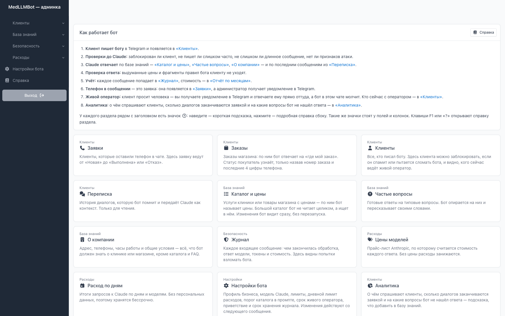
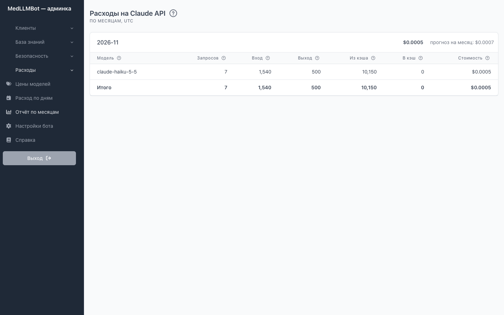
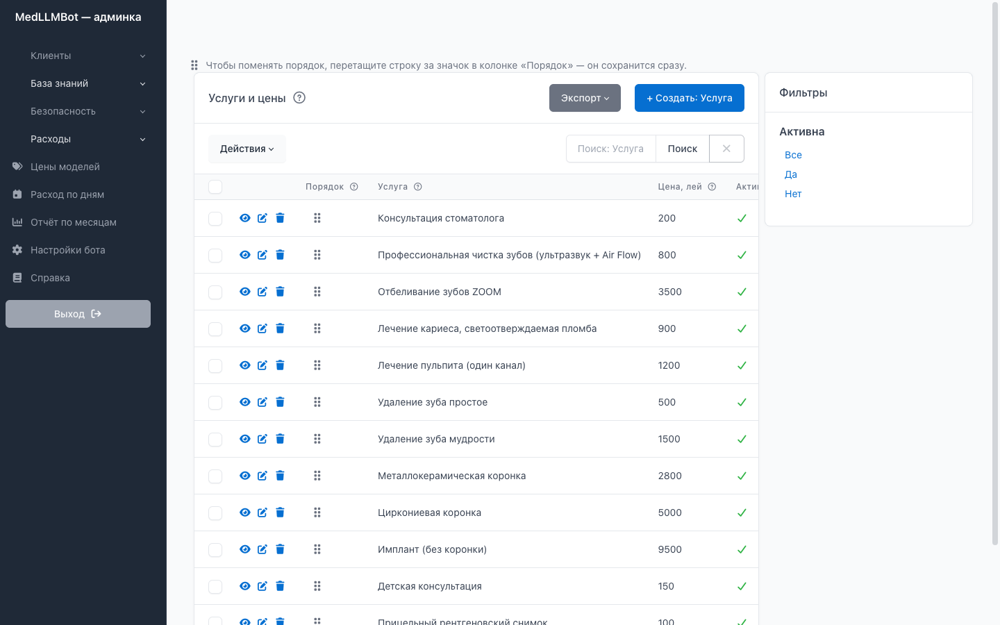
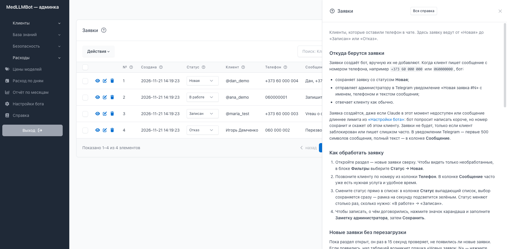
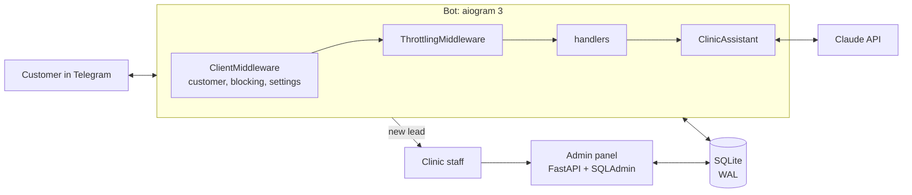

# MedLLMBot: a Telegram assistant for a dental clinic, with a web admin panel

[](https://github.com/epythonic/MedLLMBot/actions/workflows/ci.yml)

[Русская версия](README_ru.md)

A demo project: a Telegram bot built on **aiogram 3** and **Claude (Anthropic API)** that answers a dental clinic's
customers — services, prices, address, opening hours, booking — in Russian and Romanian. All data lives in **SQLite**,
and the clinic's staff manage it in a **web admin panel** (FastAPI + SQLAdmin): price list, FAQ, leads, customers and
bot settings. Changes take effect without a restart.

> "Demo Dental Clinic" is fictional; all demo data is made up ([medllmbot/db/seed.py](medllmbot/db/seed.py)).
> The admin panel and the bot's messages are in Russian, the clinic's working language.

The architecture is not tied to dentistry: a knowledge base edited by staff, lead capture, an audit log, cost
tracking and prompt-injection defences fit any business that answers customers in a messenger — an online store
included.

**Two demo profiles.** One command (`seed --reset --profile shop`) switches the same bot to a fictional electronics
store, "Demo Electro": 64 products, delivery, warranty and instalments. The profile sets the bot's role and domain
rules — the clinic never diagnoses and books appointments, the store helps pick a device for a budget, never
promises stock and hands orders to a manager — while the security rules are shared. The store's catalog is above the
"catalog in prompt" threshold, so Claude searches it with a tool. The store also answers "where is my order?": an
`order_status` tool returns the status, items, total and delivery date only after the customer gives the order number
and the last 4 digits of the order's phone. Orders come from an `OrderBackend` interface — a database table in the demo,
the store's own system (CMS, ERP) in a real project.

## What it does

**The bot**

- Answers only from the clinic's knowledge base (about the clinic, services with prices, FAQ) and remembers the
  last messages of the conversation.
- Checks every price in the model's answer against the price list in the database. If the model invents a price,
  the customer never sees it.
- **Searches a large catalog on its own** (tool use): when there are more active services than the threshold in the
  settings, the price list stays out of the prompt and Claude calls a `search_catalog` tool backed by an SQLite FTS5
  full-text index, getting up to 10 matching items. The search handles other word forms ("чистку" finds "Чистка"),
  filters by price and never executes FTS syntax from the query. A small catalog still goes into the prompt in full —
  cheaper and faster.
- Turns any message with a phone number into a lead and forwards it to the administrator. The lead is saved even if
  Claude is down, the message is too long, or Telegram rejects the reply.
- Shows "typing…" while the model thinks; long answers are split to fit Telegram's message limit.
- Defends against long messages, spam and prompt injection; ignores customers blocked in the admin panel.
- Writes an **audit log**: every incoming message, including rejected ones, with the raw and the delivered answer,
  tokens, latency and attack indicators. Suspicious messages trigger a notification to the administrator.
- Calculates the **cost of every answer** from token usage and the model price list, with daily and monthly totals.

**The admin panel**

- Leads with statuses changed right in the list, customers with one-click blocking, read-only chat history.
- Knowledge base: services and prices, FAQ, clinic info. Rows are reordered by drag and drop and the bot sees the
  change immediately.
- Audit log with "suspicious" and "outcome" filters; monthly cost report with a month-end forecast.
- Question analytics: what customers ask about (topics by Russian and Romanian keywords), the share of conversations
  that end with a lead, and the questions the bot could not answer, each with a reason and a link to the log entry —
  a to-do list for the knowledge base. Computed from the audit log for 7, 30 or 90 days without calling Claude, so it
  costs nothing and customer messages are not sent anywhere else.
- Bot settings: Claude model, limits, history depth, rate limit, catalog-in-prompt threshold, greeting, log retention.
- Contextual help: a "?" icon next to every section, form field and column opens a side panel with instructions.
- Live updates via HTMX (vendored, no CDN, no `eval`): a banner announces new leads and log entries without a reload.

## Screenshots

| | |
| --- | --- |
|  |  |
| **Home** — how the bot works, map of sections | **Leads** — status changes right in the list |
|  |  |
| **Audit log** — outcome of every message, attack attempts | **Costs** — Claude API spend by month |
|  |  |
| **Services and prices** — drag-and-drop ordering | **Help "?"** — section guide in a side panel |

## Architecture



Message pipeline: register the customer and drop blocked ones → rate limit → length and attack-indicator checks →
knowledge base and history from the database → Claude (searching a large catalog with a tool) → output checks (system-prompt leak, unknown prices,
truncated/empty answer, refusal) → audit log → reply, admin alert, lead. An unexpected error at any step still ends
with a polite reply to the customer.

## Security

| Threat | Mitigation |
| --- | --- |
| Prompt injection | System-prompt rules take precedence over customer messages; the knowledge base is isolated in `<info>`. RU / RO / EN heuristics flag attempts (ignore instructions, role change, "I am your boss", prompt extraction, markup, known jailbreaks); flagged messages never enter the model's history, so multi-turn attacks don't accumulate |
| System-prompt leak | Answers containing verbatim fragments of the rules are replaced with a neutral reply (paraphrases are not detected — the prompt itself is the defence) |
| Invented prices and discounts | Every price in the answer is checked against the current price list, including when the catalog is searched with a tool instead of sent in the prompt |
| Spam and API spend | Per-chat rate limit, message length limit before any API call, customer blocking, and a global daily spend limit after which the bot answers without Claude |
| API failures | 30 s timeout, one SDK retry, then a polite fallback; the lead is still saved |
| Admin access | Credentials from `.env`, constant-time comparison, lock-out after 5 failed logins per IP for 15 minutes, signed HttpOnly session cookie (8 hours, `Secure` behind HTTPS), CSP and `X-Frame-Options`, no caching of pages with personal data |
| Someone else's order | Order status only for the order number plus the last 4 digits of the order's phone; a wrong number and a wrong phone get the same reply; 5 failed checks per hour from one chat stop the lookups; the phone never reaches the model |
| Personal data | Log retention is configurable (90 days by default); daily cost totals contain no personal data |

## Tech stack

Python 3.14, aiogram 3, Anthropic Python SDK, SQLAlchemy 2 (async) + aiosqlite, Alembic, FastAPI + SQLAdmin,
HTMX, pydantic-settings, pytest, ruff, basedpyright (recommended mode, zero warnings), uv, Docker Compose, GitHub Actions.

## Quick start

```bash
uv sync
cp .env.example .env      # fill in: Telegram token, your chat id, Anthropic key, admin password and secret key
uv run python -m medllmbot.db.migrate
uv run python -m medllmbot.db.seed      # demo data
uv run python -m medllmbot              # the bot
uv run python -m medllmbot.admin        # the admin panel: http://127.0.0.1:8000/admin
```

If a variable is missing, the bot and the admin panel list what to fix instead of printing a traceback.

Docker:

```bash
docker compose up -d --build
docker compose run --rm migrate python -m medllmbot.db.seed
```

## Demo server

A small VPS (1 vCPU, 1 GB RAM) with Docker and a domain pointing at it is enough. Add `DOMAIN=…` and
`ADMIN_HTTPS_ONLY=true` to `.env`, then:

```bash
docker compose --profile https up -d --build        # bot + admin + Caddy with automatic Let's Encrypt HTTPS
docker compose run --rm migrate python -m medllmbot.db.seed
```

Set **daily spend limit** in the admin panel ("Bot settings"): once it is reached, the bot stops calling Claude
until midnight UTC, still saves leads and notifies the administrator. After a demo, reset everything to the
initial state (customers, chats, leads, orders and the log are removed; spend totals and the limit are kept):

```bash
docker compose run --rm migrate python -m medllmbot.db.seed --reset                  # dental clinic
docker compose run --rm migrate python -m medllmbot.db.seed --reset --profile shop   # electronics store
```

If the demo is reset nightly by cron, add the profile there too, or the demo turns back into the clinic overnight.

### Continuous deployment

`main` accepts changes only through pull requests with green `test` and `docker` checks. After a merge, CI
validates the keys stored in the GitHub Environment `demo`, builds `.env` from them and runs
[deploy/deploy.sh](deploy/deploy.sh) on the server over SSH: fast-forward to `main`, rebuild the containers,
wait until the admin panel is healthy. The CI key is bound to that script in `authorized_keys`, and the server's
host key is pinned. Setup steps are in the Russian README, section [«Demo on server»](README_ru.md#демо-на-сервере).

## Development

```bash
uv run pytest
uv run ruff check . && uv run ruff format --check .
uv run basedpyright
```

Tests never touch the network: the Anthropic client and Telegram objects are replaced with fakes. CI runs linting,
type checking and tests on Python 3.14, checks the demo server keys, and builds the Docker image.

## Limitations of the demo

- Long polling only (no webhook); rate-limit and login counters live in one process's memory.
- A single admin account without roles.
- Edited messages are not re-read; two quick messages from the same customer are processed in parallel.

## License

[MIT](LICENSE). Vendored libraries in `medllmbot/admin/static/` ship with their own licenses (htmx — 0BSD, SortableJS — MIT).
