# MedLLMBot: bot Telegram de asistență pentru o clinică stomatologică, cu panou de administrare web

[](https://github.com/epythonic/MedLLMBot/actions/workflows/ci.yml)

[English](README.md) · [Русский](README_ru.md) · **Română** · [Istoricul modificărilor](CHANGELOG.md)

Proiect demonstrativ: un bot Telegram construit cu **aiogram 3** și **Claude (Anthropic API)**. Botul răspunde clienților unei clinici stomatologice la întrebări despre servicii, prețuri, adresă, program și programări, în limbile rusă și română. Toate datele sunt stocate în **SQLite**, iar administratorul clinicii le gestionează prin **panoul de administrare web** (FastAPI + SQLAdmin), în rusă, română sau engleză: lista de prețuri, întrebările frecvente, cererile, clienții, setările botului. Modificările se aplică fără repornire.

> Clinica „Demo Dental Clinic” este fictivă, toate datele demonstrative sunt inventate ([medllmbot/db/seed.py](medllmbot/db/seed.py)).

**Două profiluri demo.** Același bot trece la un magazin fictiv de electronice, „Demo Electro”
(64 de produse, livrare, garanție, plată în rate), cu o singură comandă — `seed --reset --profile shop`. Profilul stabilește rolul botului
și regulile de domeniu: botul clinicii nu pune diagnostice și face programări la consultație, iar cel al magazinului ajută la alegerea produselor
în limita bugetului, nu promite disponibilitatea în stoc și plasează comanda prin intermediul managerului. Regulile de securitate sunt comune pentru ambele profiluri.
Catalogul magazinului depășește pragul „Catalog în prompt”, de aceea acolo Claude caută produsele cu ajutorul unui instrument.
În plus, magazinul răspunde la întrebarea „unde este comanda mea?”: instrumentul `order_status` arată statusul, produsele, suma și data
livrării doar dacă cumpărătorul a indicat numărul comenzii și ultimele 4 cifre ale telefonului din comandă.

## Funcționalități

### Botul

- Răspunde doar din baza de cunoștințe a clinicii: secțiunile „despre clinică”, serviciile cu prețuri, FAQ.
- Ține minte ultimele mesaje din dialog; istoricul este stocat în SQLite.
- Compară prețurile din răspunsul modelului cu lista de prețuri. Dacă modelul a numit un preț inventat, clientul nu îl va vedea.
- **Caută singur într-un catalog mare** (tool use): dacă numărul serviciilor active depășește pragul din setări, lista de prețuri nu este inclusă integral în prompt — Claude apelează instrumentul `search_catalog`, care caută în indexul full-text SQLite FTS5, primește până la 10 poziții potrivite și răspunde pe baza lor. Căutarea înțelege diferite forme ale cuvântului („чистку” → „Чистка”), filtrează după preț și nu execută sintaxa FTS din interogare. Un catalog mic este inclus în continuare integral în prompt — așa este mai ieftin și mai rapid.
- Cererea cu număr de telefon (numere moldovenești în orice format și internaționale cu „+”) este salvată cu statusul „Nouă” și trimisă administratorului. Cererea nu se pierde nici dacă LLM-ul nu este disponibil, mesajul depășește limita sau Telegram nu a acceptat răspunsul către client.
- **Cheamă un om:** clientul scrie „chemați un manager”, „vreau să vorbesc cu un om” (în rusă sau în română) sau /operator — administratorul primește o notificare cu ultimele mesaje și răspunde direct din Telegram, printr-un răspuns (reply) la mesajul botului. Cât timp dialogul este la operator, botul tace și trimite administratorului mesajele clientului, inclusiv fotografiile, fără a apela Claude. Butonul „Înapoi la bot” sau termenul din setări readuc dialogul la bot.
- Răspunsurile predefinite, fără model („Voi verifica cu administratorul”, „Mesajul este prea lung”, scuzele pentru o defecțiune), sunt în limba clientului: rusă sau română. Limba se determină după mesaj, iar dacă din el nu se poate deduce (o comandă pentru bot, un număr de comandă, o fotografie fără descriere) — după limba Telegram a clientului. Salutul la /start se alege după limba Telegram, iar clienții cu Telegram în altă limbă primesc ambele saluturi.
- Cât timp modelul se gândește, clientul vede „scrie…”. Un răspuns lung vine în mai multe mesaje, în limita impusă de Telegram.
- Este protejat împotriva mesajelor lungi, a spamului și a atacurilor de tip prompt injection. Ignoră clienții blocați în panoul de administrare.
- Ține un **jurnal de audit**: fiecare mesaj primit, inclusiv cele respinse, cu răspunsul modelului, tokenurile, latența și semnele unei încercări de a prelua controlul. Despre mesajele suspecte îl anunță pe administrator.
- Calculează **costul fiecărui răspuns** în tokenuri și dolari, după lista de prețuri a modelelor, și acumulează totaluri zilnice pentru raportul lunar.

### Panoul de administrare

- **Cereri:** listă cu filtru după status (Nouă / În lucru / Finalizată / Respinsă) și notițele administratorului.
- **Comenzi** (magazin): număr, cumpărător, status, produse, sumă, data livrării — pe baza lor botul răspunde despre comandă. În demo este un tabel din baza de date, iar pentru un magazin real — sistemul lui de evidență (CMS, 1C), prin interfața `OrderBackend`.
- **Clienți:** cine a scris și când, blocare cu o singură bifă, cine este acum preluat de operator.
- **Analiză:** despre ce întreabă clienții (subiecte după cuvinte-cheie în rusă și română), ce pondere din dialoguri se încheie cu o cerere și la ce întrebări botul nu a găsit răspuns — cu motivul și un link spre înregistrarea din jurnal. Este un indiciu despre ce trebuie adăugat în baza de cunoștințe. Se calculează din jurnal pentru 7, 30 sau 90 de zile, fără a apela Claude: nu costă nimic, iar conversațiile clienților nu ajung nicăieri altundeva.
- **Conversații:** jurnalul dialogurilor, doar pentru citire, cu căutare și filtru după chat.
- **Bază de cunoștințe:** servicii și prețuri, întrebări frecvente, secțiuni despre clinică. Ordinea se schimbă prin glisarea rândurilor (SortableJS + HTMX) și este vizibilă imediat pentru bot; înregistrările pot fi dezactivate fără a fi șterse. Căutarea în chirilică nu ține cont de majuscule și minuscule.
- **Jurnal:** toate mesajele primite, cu rezultatul procesării, răspunsul brut și cel trimis, tokenurile, latența și ce a căutat modelul în catalog. Filtrele „Suspect” și „Rezultat”, doar pentru citire.
- **Cheltuieli:** raport lunar defalcat pe modele, cu prognoză pentru luna curentă, cheltuieli pe zile, lista de prețuri a modelelor (se editează când Anthropic schimbă prețurile).
- **Setările botului:** modelul Claude, limitele, adâncimea istoricului, rate-limit, pragul „Catalog în prompt”, salutul în rusă și în română, limba mesajelor către administrator, termenul de păstrare a jurnalului. Valorile sunt validate de formular și de restricțiile CHECK din baza de date.
- **Formulare:** erorile de introducere sunt afișate în limba panoului de administrare (cataloagele WTForms, în rusă — cu corecturi ale traducerilor inexacte), iar prețurile cu zecimale sunt acceptate atât cu punct, cât și cu virgulă.
- **Acțiuni rapide cu HTMX:** statusul cererii se schimbă direct în listă, „Cereri” și „Jurnal” afișează fără reîncărcare un banner despre înregistrările noi (evenimentele suspecte sunt evidențiate), iar clientul poate fi blocat de pe pagina înregistrării din jurnal. HTMX se află în proiect, nu pe un CDN, funcționează fără `eval`, iar solicitările care modifică date sunt acceptate doar cu antetul `HX-Request`.
- **Ajutor „?”:** pictograma „?” se află lângă fiecare secțiune, câmp de formular și coloană de tabel. La trecerea cursorului apare un indiciu scurt, iar la clic se deschide un panou lateral cu instrucțiuni detaliate. Panoul nu acoperă pagina; îl deschid și tastele F1 și „?”. Pe pagina principală se află schema de funcționare a botului și harta secțiunilor, iar pe pagina „Ajutor” — toată documentația, cu cuprins.
- **Trei limbi:** interfața, ajutorul „?” și mesajele botului către administrator în Telegram sunt în rusă, română și engleză. Panoul de administrare se deschide în limba browserului (altfel în engleză), iar selectorul din meniu reține alegerea; limba notificărilor din Telegram se stabilește în „Setările botului”. Traducerile sunt cataloage gettext (`medllmbot/locales`); se traduc și statusurile, rezultatele din jurnal, subiectele analizei și semnele de atac. Un test nu lasă să treacă niciun șir din interfață fără traducere în rusă sau română.

## Capturi de ecran ale panoului de administrare

Datele demonstrative sunt fictive.

| | |
| --- | --- |
| 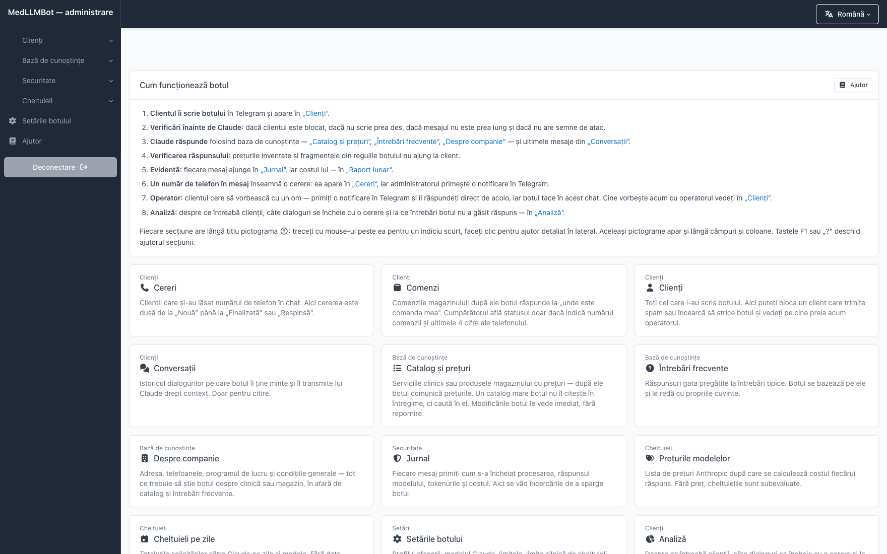 | 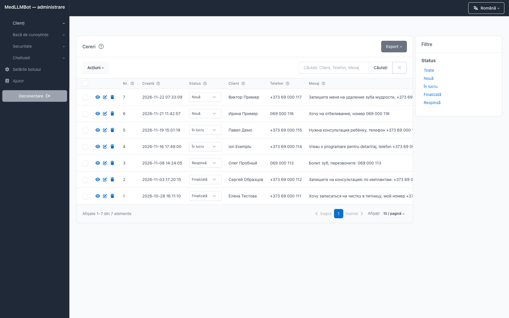 |
| **Pagina principală** — cum funcționează botul și harta secțiunilor | **Cereri** — statusul se schimbă direct în listă |
| 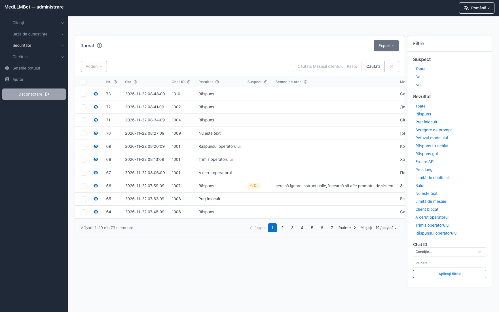 | 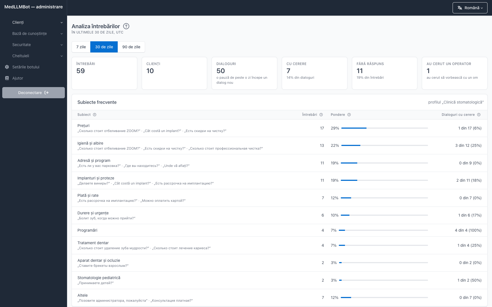 |
| **Jurnal** — rezultatul procesării fiecărui mesaj, încercările de atac, operatorul | **Analiză** — despre ce se întreabă, ponderea dialogurilor cu cerere, întrebările fără răspuns |
| 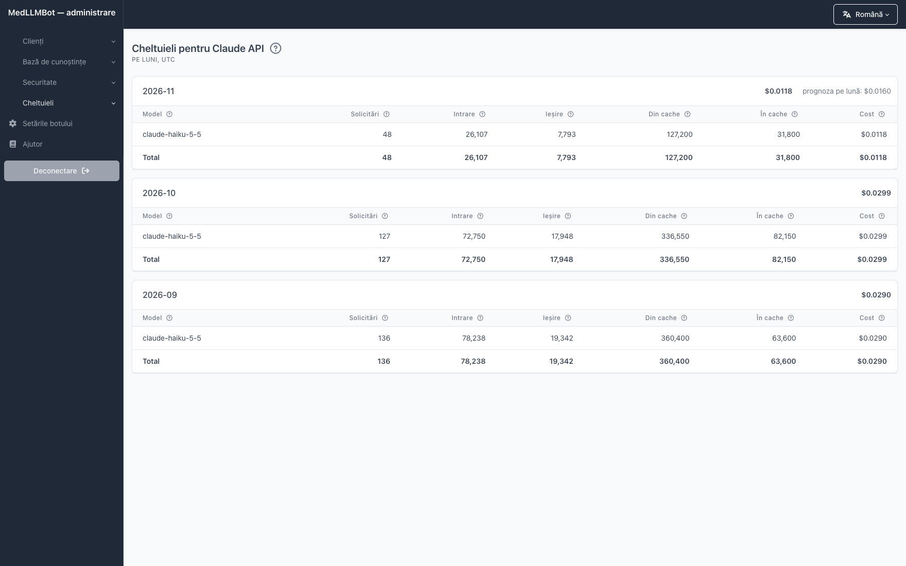 | 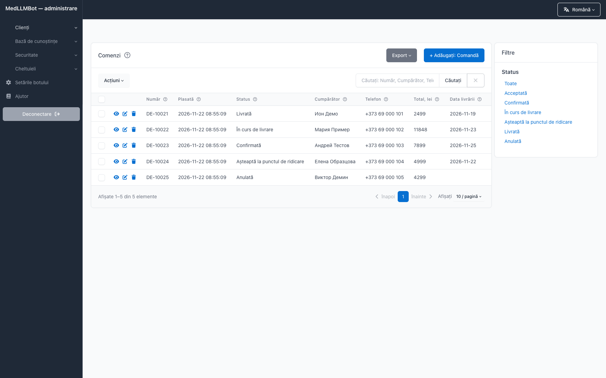 |
| **Cheltuieli** — costul solicitărilor către Claude pe luni și prognoza | **Comenzi** (magazin) — statusurile pe care botul le comunică cumpărătorului |
| 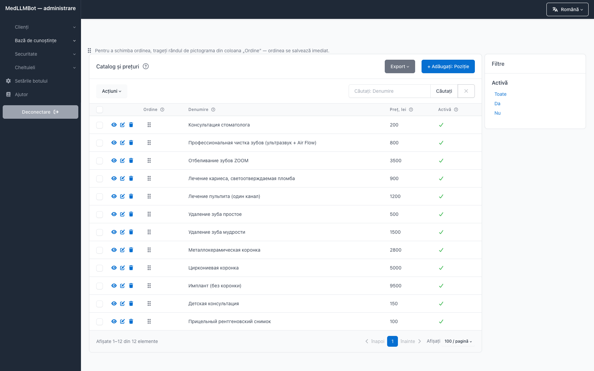 | 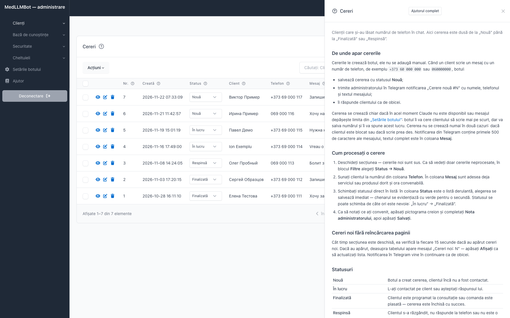 |
| **Catalog și prețuri** — ordinea se schimbă prin glisare | **Ajutor „?”** — instrucțiunile secțiunii în panoul lateral |

## Arhitectură

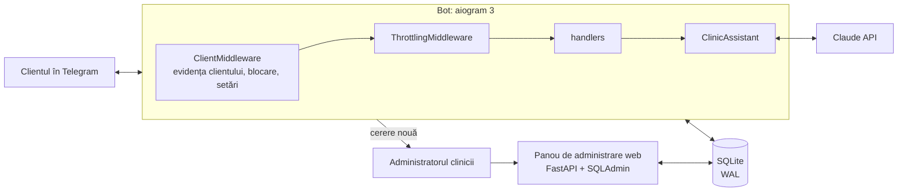

Cum procesează botul un mesaj:

1. `ClientMiddleware` creează sau actualizează clientul. Pe cei blocați îi oprește și îi înregistrează în jurnal, iar handlerului îi transmite setările din `bot_config`.
2. `ThrottlingMiddleware` lasă să treacă cel mult N mesaje în M secunde, iar pe cele oprite le înregistrează în jurnal. Limitele se iau din setări, iar contoarele sunt păstrate în memorie.
3. `ClinicAssistant` verifică lungimea mesajului și dacă acesta conține semne de atac, apoi citește din baza de date baza de cunoștințe și istoricul, construiește promptul de sistem și îl întreabă pe Claude. Dacă catalogul depășește pragul, modelul primește instrumentul `search_catalog` și poate căuta de mai multe ori în catalog înainte de a răspunde.
4. În răspunsul modelului se caută scurgeri ale promptului de sistem și prețuri care nu sunt în lista de prețuri, iar marcajul Markdown este eliminat. Un schimb obișnuit se salvează în istoric, unul suspect — nu.
5. Orice rezultat se înregistrează în jurnalul de audit.
6. Handlerul trimite răspunsul (pe cel lung — în mai multe părți). Dacă mesajul este suspect, administratorul primește o notificare (cel mult o dată la 15 minute pentru fiecare client). Dacă există un număr de telefon, se creează o cerere — chiar și atunci când Telegram nu a acceptat răspunsul către client.
7. O eroare neprevăzută la orice pas este interceptată: clientul primește scuze, iar eroarea ajunge în log.

`/start` și mesajele non-text (fotografii, mesaje vocale) ajung și ele în jurnal, cu rezultatele „Salut” și „Nu este text”.

### Schema bazei de date

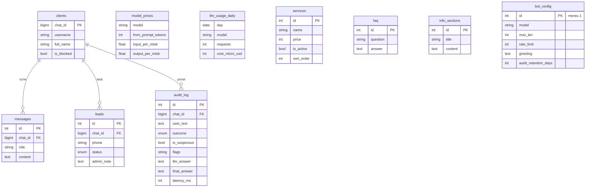

Schema este gestionată de **Alembic**. Botul și panoul de administrare aplică singure migrațiile la pornire. În Docker, acestea sunt aplicate în prealabil de serviciul `migrate`, astfel încât cele două procese să nu actualizeze schema simultan. SQLite funcționează în modul **WAL** cu `busy_timeout`, de aceea botul și panoul de administrare lucrează fără probleme cu aceeași bază de date în același timp. Cheile externe sunt activate (`PRAGMA foreign_keys`).

## Securitate

| Amenințare | Cum este acoperită |
| --- | --- |
| Prompt injection („acum ești un alt bot”) | Regulile din promptul de sistem sunt declarate mai importante decât mesajele clientului, iar baza de cunoștințe este izolată în `<info>` |
| Detectarea atacurilor | Euristicile pentru RU / RO / EN detectează cererile de a uita instrucțiunile, schimbarea rolului, „sunt șeful tău / proprietarul clinicii”, încercările de a afla promptul, marcajul de serviciu și jailbreak-urile cunoscute. Astfel de mesaje sunt marcate în jurnal, iar administratorul primește o notificare. Încercările de atac nu ajung în istoricul pe care îl vede modelul, de aceea un atac în mai mulți pași nu se acumulează |
| Scurgerea promptului de sistem | Răspunsul modelului este comparat cu regulile din prompt. Dacă conține fragmente textuale din ele, clientul primește un răspuns de rezervă, iar în jurnal rămân ambele răspunsuri. Parafrazarea sau traducerea regulilor nu este prinsă de această verificare — împotriva lor protejează chiar promptul |
| Prețuri și reduceri inventate | `PriceChecker` compară prețurile din răspuns cu lista de prețuri actuală din baza de date (înțelege „1 200 лей”, „1.200 lei”, „900 леев”), inclusiv atunci când catalogul nu este în prompt, iar modelul caută în el cu un instrument. Bugetul clientului este lăsat să treacă doar dacă clientul însuși a numit această sumă, iar în răspuns ea apare ca limită („până la 10 000 de lei”), nu ca preț al unui produs sau ca reducere |
| Spam și consumul API | Rate-limit pentru fiecare chat, limita de lungime a mesajului înainte de solicitarea către API, blocarea clienților în panoul de administrare. Limită zilnică de cheltuieli comună pentru toți: după atingerea ei, până la miezul nopții UTC botul răspunde fără Claude, cererile se salvează, iar administratorul primește o notificare |
| Sfaturi medicale | Botul nu pune diagnostice și, în caz de durere acută, îndrumă pacientul la consultație |
| Defecțiunea API | Timeout de 30 s și o reîncercare din SDK — clientul nu așteaptă mai mult de un minut. Apoi primește un răspuns politicos de rezervă, iar cererea se salvează oricum. Orice eroare neprevăzută (de exemplu, baza de date ocupată) se încheie tot cu un răspuns către client, nu cu tăcere |
| Răspuns trunchiat sau gol, refuzul modelului | Se verifică `stop_reason`: un răspuns care a atins `max_tokens` sau fereastra de context, un răspuns gol și un refuz (`refusal`) nu sunt trimise clientului — acesta primește o frază neutră, iar în jurnal rămân răspunsul original și rezultatul („Răspuns trunchiat”, „Răspuns gol”, „Refuzul modelului”) |
| Accesul la panoul de administrare | Nume de utilizator și parolă din `.env`, comparate în timp constant. După 5 încercări eșuate de pe aceeași adresă, autentificarea este blocată pentru 15 minute. Sesiunea este păstrată într-un cookie semnat (HttpOnly, SameSite=Lax, 8 ore, `Secure` cu `ADMIN_HTTPS_ONLY=true`); schimbarea parolei încheie toate sesiunile. Antete CSP, `X-Frame-Options: DENY`, `nosniff`, paginile cu date nu sunt puse în cache. În Docker, portul este deschis doar pe `127.0.0.1` |
| Date cu caracter personal în jurnal | Termenul de păstrare se configurează în panoul de administrare (implicit 90 de zile), iar botul șterge înregistrările vechi la fiecare 6 ore |
| Comenzile altor persoane | Statusul comenzii este afișat doar pe baza numărului și a ultimelor 4 cifre ale telefonului din comandă; la un număr greșit și la un telefon greșit răspunsul este același. După 5 verificări eșuate într-o oră din același chat, botul nu mai caută comenzi. Telefonul nu este transmis modelului |
| Scurgerea secretelor | Tokenurile sunt doar în `.env`, iar în cod sunt folosite ca `SecretStr`. `.env` este exclus din git și din imaginea Docker |

## Stack tehnologic

Python 3.14, aiogram 3, Anthropic Python SDK, SQLAlchemy 2 (async) + aiosqlite, Alembic, FastAPI + SQLAdmin, HTMX, pydantic-settings, pytest, ruff, basedpyright (modul recommended, zero avertismente), uv, Docker Compose, GitHub Actions.

## Structura proiectului

```text
medllmbot/
├── __main__.py        # pornirea botului: migrații → polling
├── main.py            # asamblarea dependențelor botului
├── config.py          # secrete și căi din mediu (pydantic-settings)
├── handlers.py        # handlerele Telegram
├── middlewares.py     # ClientMiddleware, ThrottlingMiddleware
├── assistant.py       # baza de cunoștințe + istoricul → LLM → verificarea prețurilor → salvare
├── llm.py             # wrapper peste Anthropic API: bucla tool use, tratarea erorilor
├── tools.py           # instrumentele search_catalog și order_status: scheme, validarea parametrilor, rezultatul pentru model
├── orders.py          # OrderBackend — interfața către sistemul de comenzi al magazinului, protecție împotriva ghicirii
├── operator.py        # operatorul uman: cererea de a chema un om, termene, texte pentru administrator
├── operator_handlers.py # handlerele operatorului: redirecționare în ambele sensuri, butonul „Înapoi la bot”
├── text.py            # normalizarea textului, limba clientului, curățarea răspunsului de Markdown
├── i18n.py            # cataloagele de traduceri gettext (RU/RO/EN) și marcajul N_ pentru etichetele din codul de domeniu
├── locales/           # ru/, ro/: messages.po — traducerile panoului de administrare și ale mesajelor către administrator
├── guards.py          # RateLimiter, PriceChecker, detectarea numărului de telefon
├── security.py        # detectorul de prompt injection, verificarea scurgerii promptului
├── maintenance.py     # curățarea în fundal a jurnalului după termenul de păstrare
├── costs.py           # lista de prețuri, costul solicitării, raportul lunar
├── analytics.py       # analiza întrebărilor: subiecte, dialoguri cu cerere, întrebări fără răspuns
├── prompts.py         # promptul de sistem și randarea bazei de cunoștințe
├── profiles.py        # profilurile afacerii: rolul botului și regulile de domeniu (clinică stomatologică, magazin)
├── db/
│   ├── models.py      # modelele SQLAlchemy
│   ├── repository.py  # toate interogările botului către baza de date
│   ├── fts.py         # indexul full-text al catalogului (SQLite FTS5) și interogarea lui
│   ├── engine.py      # motorul SQLite: WAL, foreign keys, busy_timeout, lower() cu chirilică
│   ├── migrate.py     # python -m medllmbot.db.migrate
│   ├── seed.py        # python -m medllmbot.db.seed — date demo, --profile shop — magazinul
│   ├── demo_shop.py   # datele demo ale magazinului fictiv de electronice
│   └── migrations/    # Alembic
└── admin/
    ├── __main__.py    # python -m medllmbot.admin
    ├── app.py         # FastAPI + SQLAdmin
    ├── auth.py        # autentificare cu nume de utilizator și parolă, protecție împotriva forței brute, sesiune
    ├── reports.py     # paginile „Analiză” și „Raport lunar”
    ├── help.py        # ajutorul „?”: indicii pentru câmpuri, rezultatele procesării, semnele de atac
    ├── live.py        # acțiuni rapide pe HTMX: rutele fragmentelor
    ├── fragments.py   # fragmente HTML pentru HTMX
    ├── forms.py       # formularul de bază al secțiunilor: erori în limba panoului, numere cu virgulă
    ├── i18n.py        # limbile panoului peste i18n-ul SQLAdmin: alegerea limbii, catalogul românesc al șirurilor SQLAdmin
    ├── static/        # htmx-2.0.11.min.js, sortable-1.15.7.min.js (+ licențe)
    ├── templates/     # rapoarte, textele ajutorului pe limbi (help/topics/{ru,ro,en}/), ajustări ale șabloanelor SQLAdmin
    └── views.py       # secțiunile panoului de administrare
evals/shop/             # evaluarea răspunsurilor magazinului: întrebări, verificări, judecător, rulare (contra cost, manual)
tests/                 # 1209 teste, fără rețea și fără chei reale
```

## Pornire rapidă

1. Instalați [uv](https://docs.astral.sh/uv/) și dependențele:

   ```bash
   uv sync
   ```

2. Creați fișierul `.env` după model și completați-l cu valorile dvs.:

   ```bash
   cp .env.example .env
   ```

   Aveți nevoie de tokenul botului de la @BotFather, chat id-ul dvs. (îl aflați de la @userinfobot), o cheie din Anthropic Console, parola panoului de administrare
   (cel puțin 8 caractere) și cheia secretă (cel puțin 32 de caractere). Cheia poate fi generată astfel:
   `python -c "import secrets; print(secrets.token_urlsafe(32))"`. Dacă lipsește ceva, botul și panoul de administrare
   vor enumera la pornire variabilele care nu sunt setate.

3. Creați baza de date și populați-o cu date demo:

   ```bash
   uv run python -m medllmbot.db.migrate
   uv run python -m medllmbot.db.seed
   ```

4. Porniți botul și panoul de administrare în două terminale:

   ```bash
   uv run python -m medllmbot          # botul
   uv run python -m medllmbot.admin    # panoul de administrare: http://127.0.0.1:8000/admin
   ```

Administratorul trebuie să apese o dată /start în chatul cu botul, altfel Telegram nu îi va permite botului să-i scrie primul.

## Rulare în Docker

```bash
docker compose up -d --build                                  # migrate → bot + admin
docker compose run --rm migrate python -m medllmbot.db.seed   # date demo (o singură dată)
docker compose logs -f bot
```

Panoul de administrare este disponibil la <http://127.0.0.1:8000/admin>. Baza de date este stocată în volumul `bot-storage` și se păstrează la reconstruirea containerelor.

## Demo pe server

Pentru o demonstrație este suficient un VPS mic (1 vCPU, 1 GB RAM) cu Docker și un domeniu îndreptat spre server printr-o înregistrare A.
Botul funcționează prin long polling, de aceea din exterior sunt necesare doar porturile 80 și 443 — pentru HTTPS-ul panoului de administrare
(Caddy obține și reînnoiește singur certificatul Let's Encrypt). `deploy/deploy.sh` pornește stiva cu comanda
`docker compose --profile https up -d --build` (botul, panoul de administrare și Caddy); pentru a o rula manual,
setați în `.env` `DOMAIN` și `ADMIN_HTTPS_ONLY=true`.

### Cum ajung modificările pe server

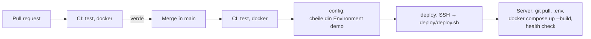

- În `main` nu se poate face push direct — se poate face doar merge la un PR cu verificările `test` și `docker` verzi (protecția ramurii).
- După merge, CI verifică cheile din GitHub Environment `demo`, generează din ele `.env` și rulează prin SSH
  pe server [deploy/deploy.sh](deploy/deploy.sh): actualizarea `main` (doar fast-forward), un `.env` nou, reconstruirea containerelor și
  așteptarea până când panoul de administrare trece health check-ul. Dacă ceva nu a pornit, deploy-ul este roșu, iar în log apar ultimele rânduri
  ale containerului.
- Cheia CI de pe server este legată de acest script (`command=` în `authorized_keys`): cu ea nu se poate executa altă comandă.
  Amprenta serverului este fixată într-un secret — SSH nu va accepta un host substituit.
- Secretele aplicației sunt stocate doar în GitHub Environment `demo`; `.env` de pe server este suprascris
  la fiecare deploy, de aceea cheile se schimbă în GitHub.

### Configurarea inițială (o singură dată)

**Pe server** (utilizator din grupul `docker`):

```bash
curl -fsSL https://get.docker.com | sh
sudo usermod -aG docker "$USER"          # reautentificați-vă după această comandă
sudo git clone https://github.com/epythonic/MedLLMBot.git /opt/MedLLMBot
sudo chown -R "$USER" /opt/MedLLMBot
```

**Cheia pentru deploy** — pe calculatorul dvs.:

```bash
ssh-keygen -t ed25519 -N "" -C "github-actions-deploy" -f medllmbot-deploy
ssh-keyscan -t ed25519 SERVERUL_DVS   # verificați amprenta: pe server ssh-keygen -lf /etc/ssh/ssh_host_ed25519_key.pub
```

Adăugați cheia publică `medllmbot-deploy.pub` pe server în `~/.ssh/authorized_keys`, pe un singur rând:

```text
command="/opt/MedLLMBot/deploy/deploy.sh",no-port-forwarding,no-agent-forwarding,no-X11-forwarding,no-pty ssh-ed25519 AAAA… github-actions-deploy
```

**În GitHub** — Settings → Environments → New environment `demo`, secretele:

| Secret | Ce conține |
| --- | --- |
| `TG_TOKEN`, `ADMIN_ID`, `ANTHROPIC_API_KEY` | cheile botului, ca în `.env.example` |
| `ADMIN_PASSWORD`, `ADMIN_SECRET_KEY` | parola panoului de administrare (cel puțin 8 caractere) și cheia sesiunii (cel puțin 32) |
| `DEPLOY_HOST`, `DEPLOY_USER` | adresa serverului și utilizatorul din `authorized_keys` |
| `DEPLOY_SSH_KEY` | conținutul cheii private `medllmbot-deploy` |
| `DEPLOY_KNOWN_HOSTS` | rezultatul comenzii `ssh-keyscan` de la pasul de mai sus |

Și variabilele (Environment variables): `DOMAIN` — domeniul demo-ului, `ADMIN_USERNAME` — numele de utilizator al panoului de administrare (implicit `admin`).

**Protecția ramurii** `main` — Settings → Branches sau cu o singură comandă:

```bash
gh api -X PUT repos/epythonic/MedLLMBot/branches/main/protection --input - <<'JSON'
{
  "required_status_checks": {"strict": true, "contexts": ["test", "docker"]},
  "enforce_admins": true,
  "required_pull_request_reviews": {"required_approving_review_count": 0},
  "restrictions": null,
  "allow_force_pushes": false,
  "allow_deletions": false
}
JSON
```

**Activați deploy-ul**: Settings → Secrets and variables → Actions → Variables → `DEPLOY_ENABLED` = `true`.
Cât timp variabila lipsește, CI doar verifică codul, iar `config` și `deploy` sunt omise.

Primul deploy are loc la orice PR îmbinat în `main`. Datele demo după prima pornire:

```bash
cd /opt/MedLLMBot && docker compose run --rm migrate python -m medllmbot.db.seed
```

### Cheltuieli și resetarea demo-ului

- În panoul de administrare: „Setările botului” → **Limita de cheltuieli pe zi, $** (pentru demo ajung 1–2 $), iar în
  [Anthropic Console](https://console.anthropic.com) setați o limită lunară pentru cheie — a doua linie de apărare.
- După demonstrație, readuceți demo-ul la starea inițială. Comanda șterge clienții, conversațiile, cererile, comenzile și jurnalul,
  restabilește baza de cunoștințe, lista de prețuri a modelelor și setările; totalurile cheltuielilor și limita zilnică rămân:

  ```bash
  docker compose run --rm migrate python -m medllmbot.db.seed --reset
  ```

  Pentru ca demo-ul să se reseteze în fiecare noapte, adăugați în crontab-ul serverului:

  ```text
  0 3 * * * cd /opt/MedLLMBot && docker compose run --rm migrate python -m medllmbot.db.seed --reset
  ```

- Pentru a prezenta unui potențial client magazinul de electronice — aceeași comandă, cu profilul. Înapoi la clinica stomatologică — `--profile clinic`.
  Dacă demo-ul se resetează prin crontab, adăugați profilul și acolo, altfel noaptea demo-ul va reveni la clinica stomatologică:

  ```bash
  docker compose run --rm migrate python -m medllmbot.db.seed --reset --profile shop
  ```

## Variabile de mediu

| Variabilă | Implicit | Descriere |
| --- | --- | --- |
| `TG_TOKEN` | — | Tokenul botului de la @BotFather |
| `ADMIN_ID` | — | Chat id-ul personal al administratorului: notificări despre cereri, răspunsuri către clienți în rol de operator (cu id-ul unui grup operatorul nu funcționează) |
| `ANTHROPIC_API_KEY` | — | Cheia Anthropic API |
| `ADMIN_USERNAME` | `admin` | Numele de utilizator al panoului de administrare |
| `ADMIN_PASSWORD` | — | Parola panoului de administrare, de cel puțin 8 caractere |
| `ADMIN_SECRET_KEY` | — | Cheia de semnare a cookie-ului de sesiune, de cel puțin 32 de caractere |
| `ADMIN_HOST` / `ADMIN_PORT` | `127.0.0.1` / `8000` | Adresa panoului de administrare |
| `DOMAIN` | — | Domeniul serverului demo pentru HTTPS prin Caddy (doar cu `--profile https`) |
| `ADMIN_HTTPS_ONLY` | `false` | `true` dacă panoul de administrare este accesat prin HTTPS, în spatele unui reverse proxy: cookie-ul de sesiune va primi flagul `Secure` |
| `DB_PATH` | `storage/bot.db` | Calea către SQLite |

Modelul Claude, limitele și salutul nu se setează aici, ci în panoul de administrare, în secțiunea „Setările botului”. Implicit: `claude-haiku-5-5`, răspuns de până la 1024 de tokenuri, mesaj de până la 1024 de caractere, istoric de 8 mesaje, 10 mesaje în 60 de secunde, jurnalul se păstrează 90 de zile, fără limită zilnică de cheltuieli.

## Dezvoltare

```bash
uv run pytest                                          # teste
uv run ruff check . && uv run ruff format --check .    # linter
uv run basedpyright                                     # verificarea tipurilor
uv run alembic revision --autogenerate -m "descriere"  # migrație după modificarea modelelor
# șir nou în interfață: extrageți-l, actualizați cataloagele, apoi traduceți msgstr în rusă și în română
uv run pybabel extract -F babel.cfg -k lazy_gettext -k N_ --no-wrap -o /tmp/messages.pot .
uv run pybabel update -i /tmp/messages.pot -d medllmbot/locales -D messages --no-wrap
```

Codul, comentariile și commit-urile sunt în engleză; tot ce văd clienții și administratorul este tradus. Testele nu accesează rețeaua: clientul Anthropic și obiectele Telegram sunt înlocuite cu fake-uri. Teste separate verifică faptul că migrațiile corespund modelelor și că modificările din panoul de administrare sunt văzute imediat de bot. CI-ul din GitHub Actions rulează la fiecare push, pe Python 3.14, linterul, verificarea tipurilor (basedpyright), testele, verificarea cheilor serverului demo din GitHub Environment `demo` și construirea imaginii Docker.

### Evaluarea calității răspunsurilor

Testele verifică codul, iar calitatea răspunsurilor modelului este măsurată de un set de evaluare separat, `evals/shop/`. Acesta conține 38 de întrebări ale cumpărătorilor magazinului: prețuri, alegere în limita bugetului, produse care nu există, condiții, statusul comenzii, regulile botului și întrebări în română. Întrebările sunt adresate botului real, cu promptul și instrumentele magazinului, pe o copie temporară a bazei de date demo. Răspunsurile sunt verificate de cod (prețurile și condițiile necesare, fără scurgeri despre comanda altcuiva, apelarea instrumentului potrivit, limba, fără Markdown) și de un judecător Claude, pe baza unei grile de evaluare: fără informații inventate, reguli respectate, răspuns util.

```bash
uv run python -m evals.shop.run --cases price-01,order-02   # pilot pe câteva întrebări
uv run python -m evals.shop.run --reps 2                    # tot setul: 76 de răspunsuri, circa $0.80 și 2,5 minute
uv run python -m evals.shop.run --regrade                   # gratuit: reverificare prin cod a răspunsurilor salvate
```

Rularea este contra cost (cheia din `.env`), de aceea se pornește manual, nu în CI. Rezultatele, conversațiile și explicațiile judecătorului se scriu în `.claude/hillclimb/shop/` (nu ajung în git). Raportul `report.html` este creat cu generatorul din skill-ul `claude-api` pentru Claude Code.

Prima rulare (claude-haiku-5-5, noiembrie 2026): **80% ± 13%** dintre răspunsuri au trecut toate verificările. Condițiile magazinului, statusul comenzii, regulile și produsele care nu există în catalog — 100%. Puncte slabe: alegerea în limita bugetului și limba română — analiza este în CHANGELOG.

După corectarea problemelor găsite — **97% ± 4%**. Toate verificările prin cod au fost trecute, iar judecătorul a găsit încălcări ale regulilor în 2 răspunsuri din 76.

## Note

- **Cache-ul promptului.** Promptul de sistem este marcat cu `cache_control`. Octeții promptului se schimbă doar atunci când administratorul editează baza de cunoștințe. Însă cache-ul funcționează doar dacă prefixul nu este mai scurt decât minimul modelului. La Haiku 5.5 acesta este de 512 tokenuri, iar promptul demo (circa 2600 de caractere) ar trebui să treacă pragul. La Haiku 4.5 minimul este de 4096 de tokenuri, iar baza de cunoștințe demo nu îl atinge. Citirile din cache se văd în loguri (`cache_read=`) și în jurnalul solicitărilor.
- **Costul este o estimare, nu o factură.** Se calculează după tokenurile din răspunsul API și prețurile din lista de prețuri (prețurile inițiale sunt preluate de pe [pagina oficială](https://platform.claude.com/docs/en/about-claude/pricing) la 10.11.2026). Se iau în calcul intrarea, ieșirea (inclusiv raționamentul modelului), scrierea și citirea din cache, precum și tariful Haiku 5.5 pentru prompturile mai lungi de 100 000 de tokenuri. Taxele și reducerile contractuale nu sunt luate în calcul. Lunile se calculează după UTC, ca în facturarea Anthropic. Banii sunt stocați în microdolari întregi, fără erori de rotunjire. Modificarea prețului în panoul de administrare nu recalculează solicitările anterioare. Totalurile zilnice nu conțin date cu caracter personal și nu se șterg odată cu jurnalul vechi.
- **Detectorul de atacuri este un semnal, nu o protecție.** Euristicile pot fi ocolite prin reformulare. Protecția o asigură regulile promptului de sistem și verificările răspunsului la ieșire (prețuri, scurgeri), iar jurnalul și notificările ajută la observarea încercărilor și la blocarea clientului.
- **Limitările versiunii demo:**
  - doar long polling (fără webhook);
  - rate-limit-ul și contorul încercărilor de autentificare sunt păstrate în memoria unui singur proces (pentru mai multe replici trebuie mutate în Redis);
  - panoul de administrare are un singur cont, fără roluri; deconectarea șterge cookie-ul din browser, dar un cookie furat rămâne valabil până la sfârșitul sesiunii (8 ore) sau până la schimbarea parolei;
  - botul nu reprocesează un mesaj corectat (editat), iar două mesaje rapide ale aceluiași client sunt procesate în paralel.

## Licență

[MIT](LICENSE). Bibliotecile terțe incluse în `medllmbot/admin/static/` au propriile licențe alături (htmx — 0BSD, SortableJS — MIT).
