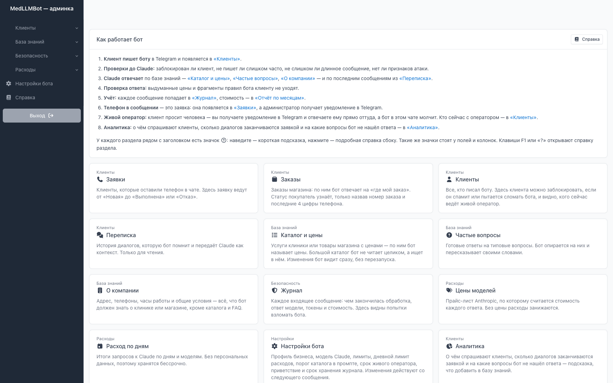
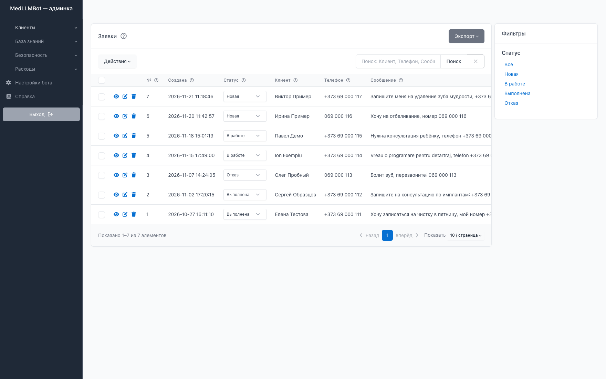
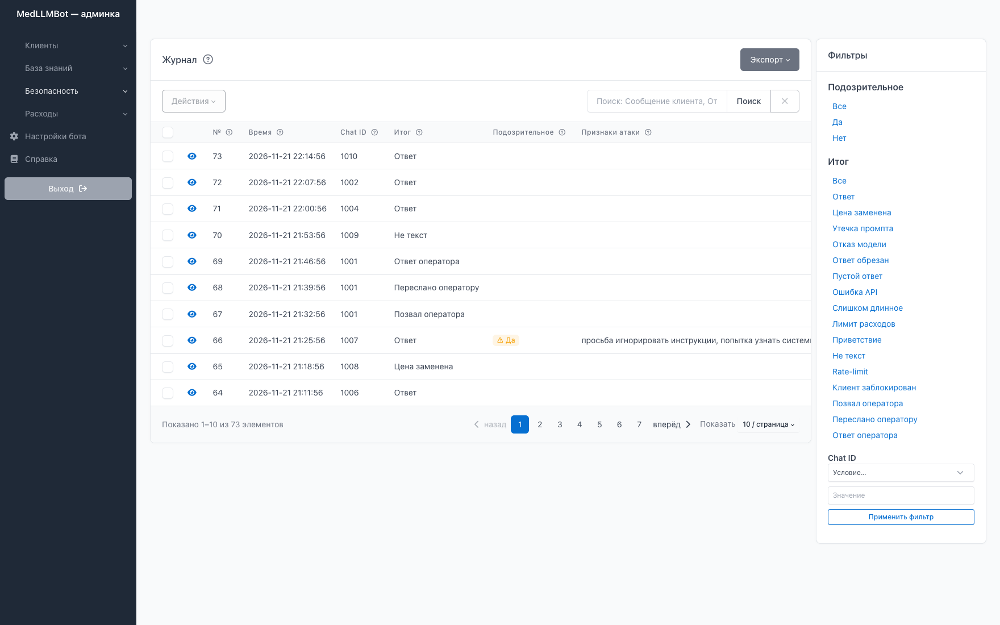
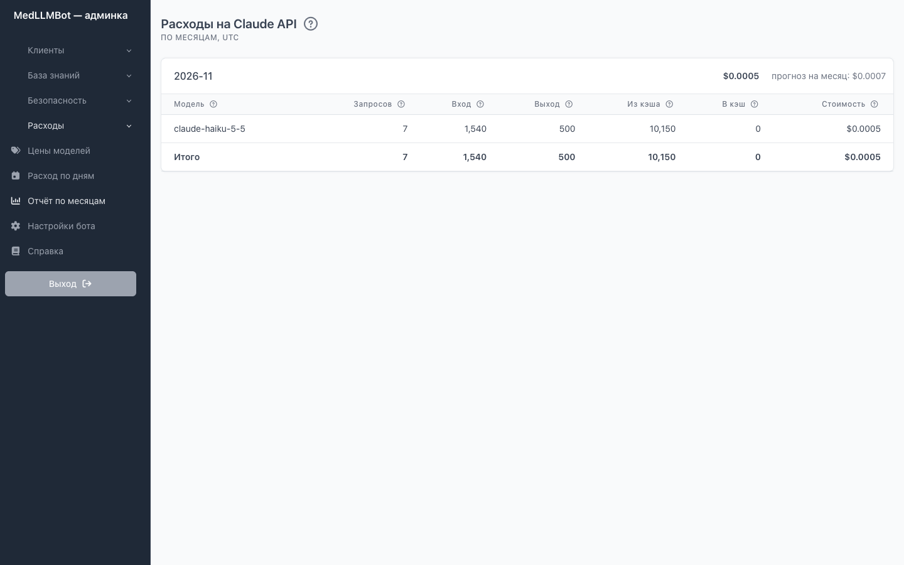
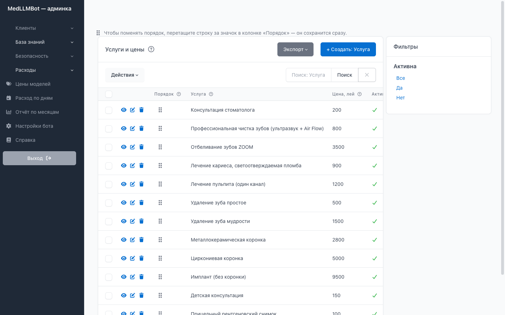
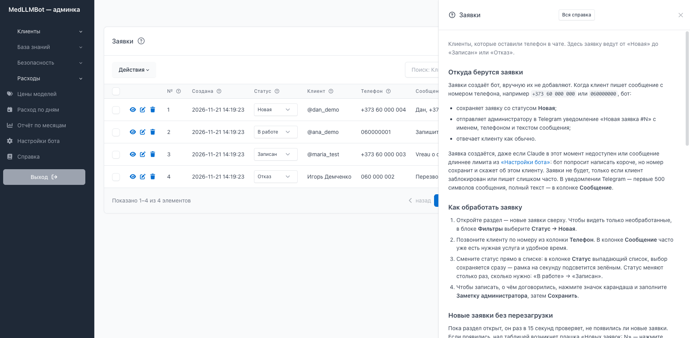
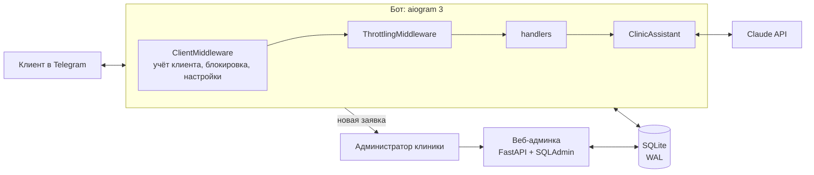
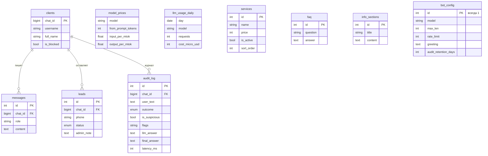
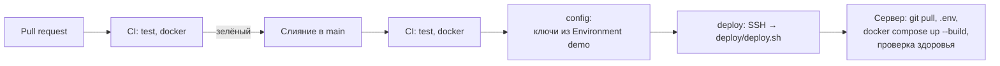

# MedLLMBot: Telegram-бот помощник стоматологии с веб-админкой

[](https://github.com/epythonic/MedLLMBot/actions/workflows/ci.yml)

[English version](README.md)

Демо-проект: Telegram-бот на **aiogram 3** и **Claude (Anthropic API)**. Он отвечает клиентам стоматологической клиники на вопросы об услугах, ценах, адресе и записи, на русском и румынском языках. Все данные хранятся в **SQLite**, а управляет ими администратор клиники через **веб-админку** (FastAPI + SQLAdmin): прайс, частые вопросы, заявки, клиенты, настройки бота. Изменения подхватываются без перезапуска.

> Клиника «Demo Dental Clinic» вымышленная, все демо-данные придуманы ([medllmbot/db/seed.py](medllmbot/db/seed.py)).

**Два демо-профиля.** Тот же бот переключается на вымышленный магазин электроники «Demo Electro»
(64 товара, доставка, гарантия, рассрочка) одной командой — `seed --reset --profile shop`. Профиль задаёт роль бота
и предметные правила: стоматология не ставит диагнозы и записывает на приём, магазин помогает выбрать технику
под бюджет, не обещает наличие и оформляет заказ через менеджера. Правила безопасности у профилей общие.
Каталог магазина больше порога «Каталог в промпте», поэтому там Claude ищет товары инструментом.

## Возможности

### Бот

- Отвечает только по базе знаний клиники: разделы «о клинике», услуги с ценами, FAQ.
- Помнит последние сообщения диалога, история хранится в SQLite.
- Сверяет цены в ответе модели с прайсом. Если модель назвала выдуманную цену, клиент её не увидит.
- **Ищет в большом каталоге сам** (tool use): если активных услуг больше порога из настроек, весь прайс в промпт не попадает — Claude вызывает инструмент `search_catalog` поверх полнотекстового индекса SQLite FTS5, получает до 10 подходящих позиций и отвечает по ним. Поиск понимает разные формы слова («чистку» → «Чистка»), фильтрует по цене и не исполняет синтаксис FTS из запроса. Маленький каталог по-прежнему идёт в промпт целиком — так дешевле и быстрее.
- Заявку с телефоном (молдавские номера в любой записи и международные с «+») сохраняет со статусом «Новая» и пересылает администратору. Заявка не теряется, даже если LLM недоступен, сообщение длиннее лимита или Telegram не принял ответ клиенту.
- Пока модель думает, клиент видит «печатает…». Длинный ответ приходит несколькими сообщениями в пределах лимита Telegram.
- Защищён от длинных сообщений, спама, prompt injection. Заблокированных в админке клиентов игнорирует.
- Пишет **журнал аудита**: каждое входящее сообщение, включая отклонённые, с ответом модели, токенами, задержкой и признаками попытки перехватить управление. О подозрительных сообщениях уведомляет администратора.
- Считает **стоимость каждого ответа** в токенах и долларах по прайс-листу моделей и копит дневные итоги для отчёта за месяц.

### Админка

- **Заявки:** список с фильтром по статусу (Новая / В работе / Выполнена / Отказ) и заметками администратора.
- **Клиенты:** кто и когда писал, блокировка одним флажком.
- **Переписка:** журнал диалогов только для чтения, с поиском и фильтром по чату.
- **База знаний:** услуги и цены, частые вопросы, разделы о клинике. Порядок меняется перетаскиванием строк (SortableJS + HTMX) и сразу виден боту; записи можно отключать без удаления. Поиск по кириллице не зависит от регистра.
- **Журнал:** все входящие сообщения с итогом обработки, сырым и отправленным ответом, токенами, задержкой и тем, что модель искала в каталоге. Фильтры «подозрительное» и «итог», только чтение.
- **Расходы:** отчёт по месяцам с разбивкой по моделям и прогнозом на текущий месяц, расход по дням, прайс-лист моделей (редактируется, когда Anthropic меняет цены).
- **Настройки бота:** модель Claude, лимиты, глубина истории, rate-limit, порог «каталог в промпте», текст приветствия, срок хранения журнала. Значения проверяются формой и CHECK-ограничениями в БД.
- **Формы:** ошибки ввода показываются по-русски (каталог WTForms с поправками неточных переводов), дробные цены принимаются и через точку, и через запятую.
- **Быстрые действия на HTMX:** статус заявки меняется прямо в списке, «Заявки» и «Журнал» без перезагрузки показывают плашку о новых записях (подозрительные события подсвечены), клиента можно заблокировать со страницы записи журнала. HTMX лежит в проекте, а не на CDN, работает без `eval`, изменяющие запросы принимаются только с заголовком `HX-Request`.
- **Справка «?»:** значок «?» стоит у каждого раздела, поля формы и колонки таблицы. При наведении показывается короткая подсказка, по клику открывается боковая панель с подробной инструкцией. Панель не закрывает страницу, её также открывают клавиши F1 и «?». На главной — схема работы бота и карта разделов, на странице «Справка» — вся документация с оглавлением. Интерфейс админки на русском.

## Скриншоты админки

Демо-данные вымышленные.

| | |
| --- | --- |
|  |  |
| **Главная** — как работает бот и карта разделов | **Заявки** — статус меняется прямо в списке |
|  |  |
| **Журнал** — итог обработки каждого сообщения, попытки атак | **Расходы** — стоимость запросов к Claude по месяцам |
|  |  |
| **Услуги и цены** — порядок меняется перетаскиванием | **Справка «?»** — инструкция к разделу в боковой панели |

## Архитектура



Как бот обрабатывает сообщение:

1. `ClientMiddleware` создаёт или обновляет клиента. Заблокированных отсекает и пишет в журнал, в хендлер передаёт настройки из `bot_config`.
2. `ThrottlingMiddleware` пропускает не больше N сообщений за M секунд, отсечённые пишет в журнал. Лимиты берутся из настроек, счётчики хранятся в памяти.
3. `ClinicAssistant` проверяет сообщение на признаки атаки и длину, затем читает из БД базу знаний и историю, собирает системный промпт и спрашивает Claude. Если каталог больше порога, модель получает инструмент `search_catalog` и может несколько раз поискать в каталоге, прежде чем ответить.
4. Ответ модели проверяется на утечку системного промпта и цены не из прайса. Обычный обмен сохраняется в историю, подозрительный — нет.
5. Любой итог записывается в журнал аудита.
6. Хендлер отправляет ответ (длинный — частями). Если сообщение подозрительное, администратору уходит уведомление (не чаще раза в 15 минут на клиента). Если есть телефон, создаётся заявка — даже когда Telegram не принял ответ клиенту.
7. Непредвиденная ошибка на любом шаге перехватывается: клиент получает извинение, ошибка — в логе.

`/start` и нетекстовые сообщения (фото, голосовые) тоже попадают в журнал, с итогами «Приветствие» и «Не текст».

### Схема БД



Схемой управляет **Alembic**. Бот и админка при старте сами применяют миграции. В Docker их заранее применяет сервис `migrate`, поэтому два процесса не обновляют схему одновременно. SQLite работает в режиме **WAL** с `busy_timeout`, поэтому бот и админка спокойно работают с одной базой одновременно. Внешние ключи включены (`PRAGMA foreign_keys`).

## Защита

| Угроза | Как закрыта |
| --- | --- |
| Prompt injection («ты теперь другой бот») | Правила в системном промпте объявлены важнее сообщений клиента, база знаний изолирована в `<info>` |
| Выявление атак | Эвристики на RU / RO / EN ловят просьбы забыть инструкции, смену роли, «я твой начальник / владелец клиники», попытки узнать промпт, служебную разметку и известные джейлбрейки. Такие сообщения отмечаются в журнале, администратор получает уведомление. Попытки атаки не попадают в историю, которую видит модель, поэтому многошаговая атака не накапливается |
| Утечка системного промпта | Ответ модели сверяется с правилами промпта. Если в нём есть их дословные фрагменты, клиент получает заглушку, а в журнале остаются оба ответа. Пересказ или перевод правил эта проверка не ловит — от него защищает сам промпт |
| Выдуманные цены и скидки | `PriceChecker` сверяет цены из ответа с актуальным прайсом в БД (понимает «1 200 лей», «1.200 lei», «900 леев»), в том числе когда каталог не в промпте, а модель ищет в нём инструментом |
| Спам и расход API | Rate-limit на каждый чат, лимит длины сообщения до запроса к API, блокировка клиентов в админке. Дневной лимит расходов на всех: после него бот до полуночи UTC отвечает без Claude, заявки сохраняются, администратор получает уведомление |
| Медицинские советы | Бот не ставит диагнозы и при острой боли направляет на приём |
| Сбой API | Тайм-аут 30 с и одна повторная попытка SDK — клиент не ждёт дольше минуты. Дальше он получает вежливую заглушку, а заявка всё равно сохраняется. Любая непредвиденная ошибка (например, занятая база) тоже заканчивается ответом клиенту, а не молчанием |
| Обрезанный или пустой ответ, отказ модели | Проверяется `stop_reason`: ответ, упёршийся в `max_tokens` или в окно контекста, пустой ответ и отказ (`refusal`) клиенту не отправляются — он получает нейтральную фразу, а в журнале остаются исходный ответ и итог («Ответ обрезан», «Пустой ответ», «Отказ модели») |
| Доступ к админке | Логин и пароль из `.env`, сравнение за постоянное время. После 5 неудачных попыток с одного адреса вход закрыт на 15 минут. Сессия в подписанной cookie (HttpOnly, SameSite=Lax, 8 часов, `Secure` при `ADMIN_HTTPS_ONLY=true`); смена пароля завершает все сессии. Заголовки CSP, `X-Frame-Options: DENY`, `nosniff`, страницы с данными не кэшируются. В Docker порт открыт только на `127.0.0.1` |
| Персональные данные в журнале | Срок хранения настраивается в админке (по умолчанию 90 дней), бот удаляет старые записи каждые 6 часов |
| Утечка секретов | Токены только в `.env`, в коде используются как `SecretStr`. `.env` исключён из git и из Docker-образа |

## Стек

Python 3.14, aiogram 3, Anthropic Python SDK, SQLAlchemy 2 (async) + aiosqlite, Alembic, FastAPI + SQLAdmin, pydantic-settings, pytest, ruff, basedpyright, uv, Docker Compose, GitHub Actions.

## Структура

```text
medllmbot/
├── __main__.py        # запуск бота: миграции → polling
├── main.py            # сборка зависимостей бота
├── config.py          # секреты и пути из окружения (pydantic-settings)
├── handlers.py        # хендлеры Telegram
├── middlewares.py     # ClientMiddleware, ThrottlingMiddleware
├── assistant.py       # база знаний + история → LLM → проверка цен → сохранение
├── llm.py             # обёртка над Anthropic API: цикл tool use, обработка ошибок
├── tools.py           # инструмент search_catalog: схема, проверка параметров, результат для модели
├── guards.py          # RateLimiter, PriceChecker, поиск телефона
├── security.py        # детектор prompt injection, проверка утечки промпта
├── maintenance.py     # фоновая очистка журнала по сроку хранения
├── costs.py           # прайс-лист, стоимость запроса, отчёт по месяцам
├── prompts.py         # системный промпт и рендер базы знаний
├── profiles.py        # профили бизнеса: роль бота и предметные правила (стоматология, магазин)
├── db/
│   ├── models.py      # модели SQLAlchemy
│   ├── repository.py  # все запросы бота к БД
│   ├── fts.py         # полнотекстовый индекс каталога (SQLite FTS5) и запрос к нему
│   ├── engine.py      # движок SQLite: WAL, foreign keys, busy_timeout, lower() с кириллицей
│   ├── migrate.py     # python -m medllmbot.db.migrate
│   ├── seed.py        # python -m medllmbot.db.seed — демо-данные, --profile shop — магазин
│   ├── demo_shop.py   # демо-данные вымышленного магазина электроники
│   └── migrations/    # Alembic
└── admin/
    ├── __main__.py    # python -m medllmbot.admin
    ├── app.py         # FastAPI + SQLAdmin
    ├── auth.py        # вход по логину и паролю, защита от перебора, сессия
    ├── reports.py     # страница «Отчёт по месяцам»
    ├── help.py        # справка «?»: подсказки полей, итоги обработки, признаки атак
    ├── live.py        # быстрые действия на HTMX: маршруты фрагментов
    ├── fragments.py   # HTML-фрагменты для HTMX
    ├── forms.py       # базовая форма разделов: ошибки по-русски, числа с запятой
    ├── static/        # htmx-2.0.11.min.js, sortable-1.15.7.min.js (+ лицензии)
    ├── templates/     # отчёт, тексты справки (help/), доработки шаблонов SQLAdmin (sqladmin/)
    └── views.py       # разделы админки
tests/                 # 609 тестов, без сети и реальных ключей
```

## Быстрый старт

1. Установите [uv](https://docs.astral.sh/uv/) и зависимости:

   ```bash
   uv sync
   ```

2. Создайте файл `.env` из образца и впишите в него свои значения:

   ```bash
   cp .env.example .env
   ```

   Нужны токен бота от @BotFather, ваш chat id (узнать у @userinfobot), ключ из Anthropic Console, пароль админки
   (от 8 символов) и секретный ключ (от 32 символов). Ключ можно сгенерировать так:
   `python -c "import secrets; print(secrets.token_urlsafe(32))"`. Если чего-то не хватает, бот и админка
   при запуске перечислят, какие переменные не заданы.

3. Создайте БД и заполните её демо-данными:

   ```bash
   uv run python -m medllmbot.db.migrate
   uv run python -m medllmbot.db.seed
   ```

4. Запустите бота и админку в двух терминалах:

   ```bash
   uv run python -m medllmbot          # бот
   uv run python -m medllmbot.admin    # админка: http://127.0.0.1:8000/admin
   ```

Администратор должен один раз нажать /start у бота, иначе Telegram не даст боту написать ему первым.

## Запуск в Docker

```bash
docker compose up -d --build                                  # migrate → bot + admin
docker compose run --rm migrate python -m medllmbot.db.seed   # демо-данные (один раз)
docker compose logs -f bot
```

Админка доступна на <http://127.0.0.1:8000/admin>. База хранится в volume `bot-storage` и переживает пересборку контейнеров.

## Демо на сервере

Для показа хватает маленького VPS (1 vCPU, 1 ГБ RAM) с Docker и домена, направленного A-записью на сервер.
Бот работает через long polling, поэтому снаружи нужны только порты 80 и 443 — для HTTPS админки
(Caddy сам получает и продлевает сертификат Let's Encrypt).

### Как изменения попадают на сервер



- В `main` нельзя запушить напрямую — только слить PR с зелёными проверками `test` и `docker` (защита ветки).
- После слияния CI проверяет ключи из GitHub Environment `demo`, собирает из них `.env` и по SSH запускает
  на сервере [deploy/deploy.sh](deploy/deploy.sh): свежий `main`, новый `.env`, пересборка контейнеров,
  ожидание, пока админка станет здоровой. Если что-то не поднялось, деплой красный, а в логе — последние строки
  контейнера.
- Ключ CI на сервере привязан к этому скрипту (`command=` в `authorized_keys`): другую команду им не выполнить.
  Отпечаток сервера закреплён в секрете — подмену хоста SSH не пропустит.
- Секреты приложения хранятся только в GitHub Environment `demo`; `.env` на сервере перезаписывается
  при каждом деплое, поэтому ключи меняют в GitHub.

### Первоначальная настройка (один раз)

**На сервере** (пользователь в группе `docker`):

```bash
curl -fsSL https://get.docker.com | sh
sudo usermod -aG docker "$USER"          # перелогиньтесь после этой команды
sudo git clone https://github.com/epythonic/MedLLMBot.git /opt/MedLLMBot
sudo chown -R "$USER" /opt/MedLLMBot
```

**Ключ для деплоя** — на своей машине:

```bash
ssh-keygen -t ed25519 -N "" -C "github-actions-deploy" -f medllmbot-deploy
ssh-keyscan -t ed25519 ВАШ_СЕРВЕР   # сверьте отпечаток: на сервере ssh-keygen -lf /etc/ssh/ssh_host_ed25519_key.pub
```

Открытый ключ `medllmbot-deploy.pub` добавьте на сервер в `~/.ssh/authorized_keys` одной строкой:

```text
command="/opt/MedLLMBot/deploy/deploy.sh",no-port-forwarding,no-agent-forwarding,no-X11-forwarding,no-pty ssh-ed25519 AAAA… github-actions-deploy
```

**В GitHub** — Settings → Environments → New environment `demo`, секреты:

| Секрет | Что положить |
| --- | --- |
| `TG_TOKEN`, `ADMIN_ID`, `ANTHROPIC_API_KEY` | ключи бота, как в `.env.example` |
| `ADMIN_PASSWORD`, `ADMIN_SECRET_KEY` | пароль админки (от 8 символов) и ключ сессии (от 32) |
| `DEPLOY_HOST`, `DEPLOY_USER` | адрес сервера и пользователь из `authorized_keys` |
| `DEPLOY_SSH_KEY` | содержимое закрытого ключа `medllmbot-deploy` |
| `DEPLOY_KNOWN_HOSTS` | вывод `ssh-keyscan` из шага выше |

И переменные (Environment variables): `DOMAIN` — домен демо, `ADMIN_USERNAME` — логин админки (по умолчанию `admin`).

**Защита ветки** `main` — Settings → Branches или одной командой:

```bash
gh api -X PUT repos/epythonic/MedLLMBot/branches/main/protection --input - <<'JSON'
{
  "required_status_checks": {"strict": true, "contexts": ["test", "docker"]},
  "enforce_admins": true,
  "required_pull_request_reviews": {"required_approving_review_count": 0},
  "restrictions": null,
  "allow_force_pushes": false,
  "allow_deletions": false
}
JSON
```

**Включите деплой**: Settings → Secrets and variables → Actions → Variables → `DEPLOY_ENABLED` = `true`.
Пока переменной нет, CI только проверяет код, а `config` и `deploy` пропускаются.

Первый деплой — любой PR, слитый в `main`. Демо-данные после первого запуска:

```bash
cd /opt/MedLLMBot && docker compose run --rm migrate python -m medllmbot.db.seed
```

### Расходы и сброс демо

- В админке «Настройки бота» → **Лимит расходов в сутки, $** (для демо хватит 1–2 $), а в
  [Anthropic Console](https://console.anthropic.com) поставьте месячный лимит на ключ — вторую линию защиты.
- После показа верните демо в исходное состояние. Команда удаляет клиентов, переписку, заявки и журнал,
  восстанавливает базу знаний, прайс-лист моделей и настройки; итоги расходов и дневной лимит остаются:

  ```bash
  docker compose run --rm migrate python -m medllmbot.db.seed --reset
  ```

  Чтобы демо сбрасывалось каждую ночь, добавьте в crontab сервера:

  ```text
  0 3 * * * cd /opt/MedLLMBot && docker compose run --rm migrate python -m medllmbot.db.seed --reset
  ```

- Показать заказчику магазин электроники — та же команда с профилем. Обратно на стоматологию — `--profile clinic`.
  Если демо сбрасывается по crontab, добавьте профиль и туда, иначе ночью демо вернётся к стоматологии:

  ```bash
  docker compose run --rm migrate python -m medllmbot.db.seed --reset --profile shop
  ```

## Переменные окружения

| Переменная | По умолчанию | Описание |
| --- | --- | --- |
| `TG_TOKEN` | — | Токен бота от @BotFather |
| `ADMIN_ID` | — | Chat id администратора для уведомлений о заявках |
| `ANTHROPIC_API_KEY` | — | Ключ Anthropic API |
| `ADMIN_USERNAME` | `admin` | Логин админки |
| `ADMIN_PASSWORD` | — | Пароль админки, не короче 8 символов |
| `ADMIN_SECRET_KEY` | — | Ключ подписи cookie сессии, не короче 32 символов |
| `ADMIN_HOST` / `ADMIN_PORT` | `127.0.0.1` / `8000` | Адрес админки |
| `DOMAIN` | — | Домен демо-сервера для HTTPS через Caddy (только с `--profile https`) |
| `ADMIN_HTTPS_ONLY` | `false` | `true`, если админка открыта по HTTPS через reverse proxy: cookie сессии получит флаг `Secure` |
| `DB_PATH` | `storage/bot.db` | Путь к SQLite |

Модель Claude, лимиты и приветствие задаются не здесь, а в админке, в разделе «Настройки бота». По умолчанию: `claude-haiku-5-5`, ответ до 1024 токенов, сообщение до 1024 символов, история из 8 сообщений, 10 сообщений за 60 секунд, журнал хранится 90 дней, дневного лимита расходов нет.

## Разработка

```bash
uv run pytest                                          # тесты
uv run ruff check . && uv run ruff format --check .    # линтер
uv run basedpyright                                     # проверка типов
uv run alembic revision --autogenerate -m "описание"   # миграция после правки моделей
```

Тесты не ходят в сеть: клиент Anthropic и объекты Telegram заменены фейками. Отдельные тесты проверяют, что миграции совпадают с моделями и что правки из админки сразу видит бот. CI в GitHub Actions на каждый push запускает на Python 3.14 линтер, проверку типов (basedpyright), тесты, проверку ключей демо-сервера из GitHub Environment `demo` и сборку Docker-образа.

## Заметки

- **Кэширование промпта.** Системный промпт помечен `cache_control`. Байты промпта меняются, только когда админ правит базу знаний. Но кэш срабатывает только когда префикс не короче минимума модели. У Haiku 5.5 это 512 токенов, и демо-промпт (около 2600 символов) должен проходить порог. У Haiku 4.5 минимум 4096 токенов, и демо-база знаний до него не дотягивает. Попадания в кэш видны в логах (`cache_read=`) и в журнале запросов.
- **Стоимость — оценка, а не счёт.** Считается по токенам из ответа API и ценам из прайс-листа (стартовые цены взяты с [официальной страницы](https://platform.claude.com/docs/en/about-claude/pricing) на 10.11.2026). Учитываются вход, выход (включая размышления модели), запись и чтение кэша, а также тариф Haiku 5.5 для промптов длиннее 100 000 токенов. Налоги и скидки по договору не учитываются. Месяцы считаются по UTC, как в биллинге Anthropic. Деньги хранятся в целых микродолларах, без ошибок округления. Изменение цены в админке не пересчитывает прошлые запросы. Дневные итоги не содержат персональных данных и не удаляются вместе со старым журналом.
- **Детектор атак — сигнал, а не защита.** Эвристики обходятся перефразированием. Защищают правила системного промпта и проверки ответа на выходе (цены, утечка), а журнал и уведомления помогают заметить попытки и заблокировать клиента.
- **Ограничения демо-версии:**
  - только long polling (без webhook);
  - rate-limit и счётчик попыток входа хранятся в памяти одного процесса (для нескольких реплик их нужно перенести в Redis);
  - у админки одна учётная запись, без ролей; выход стирает cookie в браузере, но украденная cookie живёт до конца сессии (8 часов) или до смены пароля;
  - исправленное (отредактированное) сообщение бот не перечитывает, а два быстрых сообщения одного клиента обрабатывает параллельно.

## Лицензия

[MIT](LICENSE). Вендорные библиотеки в `medllmbot/admin/static/` — со своими лицензиями рядом (htmx — 0BSD, SortableJS — MIT).
